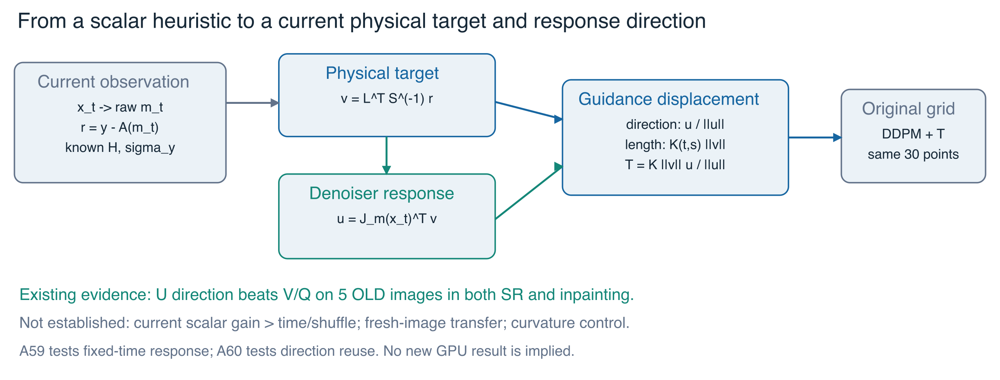
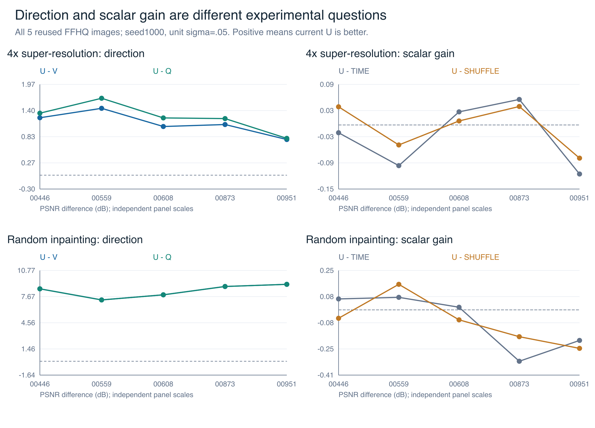
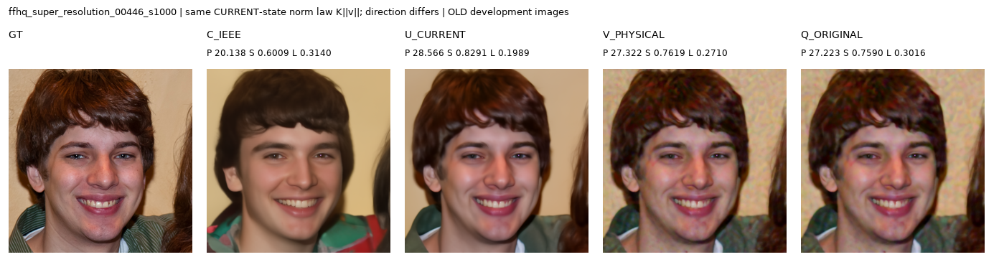
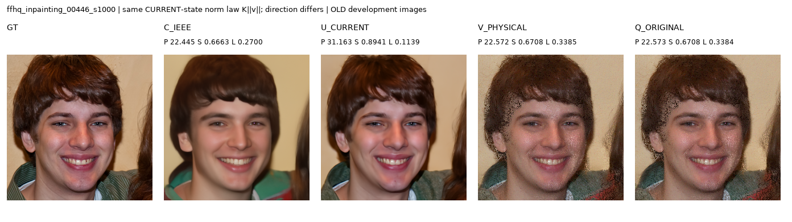

# 状态感知引导：动机、证据与27日上午关键验证

**初步结论：当前响应方向出现了明确的旧图开发信号；原开题完整体系仍未实现。**
在固定30点上，U比物理方向V和原q归一化方向Q更好；当前余弦衰减与标量g匹配没有独立支持。
因此研究应聚焦“物理目标 → 去噪器响应方向 → 引导位移”，并用新图、真实成本和局部几何验证它。
新图、四任务、跨数据集、曲率控制或300→30效率结论，都不能从旧5图推出来。

报告日期：2026-10-27。模型结果截止A55r2回传；A56-A60仅已实现并推送，服务器结果未收到。
本夜在Mac没有运行Torch/CUDA或服务器GPU。论文实验收口日期仍为10/31。

## 1. 开题动机与研究脉络

开题希望用物理一致性与内部稳定性描述当前状态，驱动步长/权重，最终在画质可比时减少推理成本。
目前用户暂停步长、步数和采样位置选择，全部保持原30点。当前工作只完成引导子问题的候选研究，不能改名为完整联合控制。

|阶段|可靠收获|与当前主线的关系|
|---|---|---|
|R 复现/协议|域、伴随、输出、精度和预算会改变结果；建立可回放本地参照|必要基础，未认证作者所有1000图均值|
|I 初始化网格|固定网格改变PSNR/LPIPS取舍|离线初始化；当前暂停，不是实时状态收益|
|A0-A20 测量与细化|读数可测，部分中点/末端动作改善|动作可行性；固定位置和额外调用不能当状态创新|
|A21-A35 同成本/反馈|固定脉冲有收益；旧双指标映射和几何预测未稳定确认|保留强参照及负结果，停止同类追分|
|A36-A49 迁移/局部目标|相对C大增益常被固定/错配解释；局部目标变好可损伤终局|重构指标与目标，关闭旧正则/rho/Nyström救分|
|A50r2-A55r2 方向与尺度分离|原q方向约束、夹角衰减与当前g被分别检验；当前U方向优于V/Q|当前最有依据的候选，仍是5旧图开发证据|

历史报告的样本、lr、unit/model域、算子与300/330调用不同，不能把不同方法的最佳数字拼成一个统一成功方案。
昨日完整梳理及库存保留在[历史综合报告](../overnight_20261026/00_integrated_report.md)，本报告更新到A55r2，不回写旧判定。

## 2. 现在的状态反馈到底是什么



图1是方法动机图，不是所有模块已有效的证明。物理残差提供“当前观测偏差”，真实输入VJP提供“去噪器对该观测方向的当前响应”。
两者决定一个向量位移；它已超出“只给原ZAPS乘一个标量”的定义。

|符号/代称|具体含义|
|---|---|
|q / C_IEEE|q是含逐图学习ζ/D的原ZAPS加性修正；C_IEEE是精度匹配本地基线|
|m / clean|m为未裁剪Tweedie估计；clean=clamp(m)供原DDPM，不可混用|
|R_raw|有效观测RMS(y-A(m))/σ_y；观测偏差，不是全图风险|
|v|噪声/算子校准的物理回投，v=L^TS⁻¹r|
|u / U_CURRENT|u=J_m^Tv；U使用它的方向并将长度校准至K‖v‖|
|V_PHYSICAL|T=Kv，不通过去噪器Jacobian；仍依赖当前状态|
|Q_ORIGINAL|沿原q方向，但归一化到同一K‖v‖规则；不是完整原版C|
|g / TIME / SHUFFLE|g=‖v‖/‖u‖；TIME取其他图同时间g，SHUFFLE取预定另一图g；这些对照仍保留当前u|
|NFE / 输入VJP|去噪器前向 / 去噪器输入反向，必须分账；CG、FFT和内部重算也不是免费|

不同策略分岔后采用同一长度规则，但每条路径的当前v不同，所以不是逐步数值长度完全相等。
V/Q和TIME/SHUFFLE都不能被笼统称为“完全无状态”。

## 3. 公式依据与能够证明的范围

令alpha为累计alpha_bar，a=√alpha，b²=1-alpha。模型域测量为A(m)=H((m+1)/2)，线性部分L=.5H。
当前代码定义：

```text
m = (x - b*eps_theta(x,t)) / a
r = y - A(m),   c = b²/a
S = sigma_y²*I + c*L*L^T
v = L^T*S⁻¹*r,   u = J_m^T*v
g = ||v||/||u||
T_U = K(t,s)*g*u
K(t,s) = (1 - alpha_t/alpha_s) / sqrt(alpha_t/alpha_s)
```

cI是各向同性代理，不是真实后验协方差。理想MMSE的条件矩关系不自动适用于有限训练网络。
固定t和常S时，代理ell=.5r^TS⁻¹r的理想负梯度为u；因此T_U具有明确的局部方向与长度解释。
其范数为K||v||，与理想代理梯度的内积为-K||v||||u||。

K由条件均值位移与原skip-DDPM clean系数相乘得到，是单位换算，不是最优步长或后验正确性证明。
实际clamp、基漂移、创新噪声、近似CG与后续状态都不受这个局部命题保证。
若gamma表示对T的倍率，纯梯度下降的充分条件涉及gamma K||v||/||u||，不是只限制gamma本身。
详细推导、数值边界和代码定位见[公式附录](FORMULAS.md)。

物理残差变小不必然提高PSNR：单位域GT=(.5,.5)，只测第一像素，(.6,.5)改成(.55,1)时，
残差从.1降到.05，全图MSE却从.005增到.12625。这个代数例子说明未观测误差不能仅靠残差识别。
A49则给出另一个局部J目标与终局错位的真实反例，不能混称当前ell的直接实证。

## 4. 目前最有判别力的结果

五张旧FFHQ图00446/00559/00608/00873/00951，seed1000，unit σ_y=.05；SR4×、随机70%补洞。
原30点固定，锁定本地FFHQ配置包含lr=.01；C不是作者1000图完全认证基线。

|任务|C_IEEE|U 当前响应|V 物理方向|Q 原q方向|
|---|---:|---:|---:|---:|
|4×超分|20.379|28.472|27.348|27.217|
|70%随机补洞|22.703|31.046|22.697|22.699|

|任务|比较|ΔPSNR/dB|ΔSSIM|ΔLPIPS|PSNR胜图|
|---|---|---:|---:|---:|---:|
|4×超分|U-V|+1.124|+0.0832|-0.0976|5/5|
|4×超分|U-Q|+1.255|+0.0908|-0.1274|5/5|
|70%随机补洞|U-V|+8.348|+0.2434|-0.2614|5/5|
|70%随机补洞|U-Q|+8.347|+0.2434|-0.2614|5/5|

A55r2中三个方向各150/150状态解决。U的10条和V的4条复用缓存；本轮新增480前向、0去噪器输入VJP。
原A55误拦算子伴随失败的1次前向另计，共481；算子局部autograd2909次，不能写成免费或网络VJP。
以上均值与差值来自用户回传，90项均值算术已复核；本机没有新增PT/实际模型回放。

|任务|当前U相对参照|ΔPSNR/dB|结论|
|---|---|---:|---|
|4×超分|其他图时间g|-0.0274|没有当前g的独立正增量|
|4×超分|错配图g|-0.0058|没有当前g的独立正增量|
|70%随机补洞|其他图时间g|-0.0709|没有当前g的独立正增量|
|70%随机补洞|错配图g|-0.0738|没有当前g的独立正增量|

这两组结果不矛盾：A55r2分离方向，A54分离标量g。方向候选有效不等于当前标量匹配有效，
也未证明每一步都需要当前Jacobian、当前图相对其他Jacobian或新图泛化。



图2各面板纵轴独立；没有置信区间或因果泛化承诺。左侧方向差异一致，右侧当前g没有稳定优于时间/错配。
[图数据与源摘要哈希](figures/figure_data.json)。不能把对C约8dB的大提升直接说成新增状态匹配收益。

## 5. 真实重建图片：作为现象展示

下面固定展示ID最小的00446，不按收益挑图；完整统计仍覆盖5图。原图未经重绘或裁切，字节指纹可核对。
这些是A55r2归档原始方向面板：GT、C_IEEE、U_CURRENT、V_PHYSICAL、Q_ORIGINAL。U复用A53的NORM_ONLY；V的部分案例也复用既有缓存。

<!-- page:landscape -->


图3：当前U在该旧图上比C清楚，三项指标对应原图标注。它展示候选现象，不证明新图泛化或当前g独立价值。

|方法（00446）|PSNR/dB|SSIM|LPIPS|
|---|---:|---:|---:|
|C_IEEE|20.138|0.6009|0.3140|
|U_CURRENT|28.566|0.8291|0.1989|
|V_PHYSICAL|27.322|0.7619|0.2710|
|Q_ORIGINAL|27.223|0.7590|0.3016|

<!-- page:landscape -->


图4：V仅作用于观测支持域，u可经去噪器向缺失区传递信息；已有U轨迹约65%-67%引导能量在缺失区。
这只是作用范围，不表示比例越大越好；原q的小波预条件也可能混合空间信息。
[A55r2归档原图、提交和无变换拷贝指纹](figures/A55r2_image_provenance.json)。归档摘要与用户回传逐字段一致。另保留[A53超分夹角面板](figures/example_sr_00446.png)和[A53补洞面板](figures/example_ip_00446.png)，不当成新增样本。

|方法（00446）|PSNR/dB|SSIM|LPIPS|
|---|---:|---:|---:|
|C_IEEE|22.445|0.6663|0.2700|
|U_CURRENT|31.163|0.8941|0.1139|
|V_PHYSICAL|22.572|0.6708|0.3385|
|Q_ORIGINAL|22.573|0.6708|0.3384|

<!-- page:portrait -->
## 6. 开题逐项证据矩阵

原PDF物理3/7/10/11/12页已完整提取和视觉核对，身份及阅读范围见[来源核查](theory_source_audit.json)。
原任务包含denoising，当前motion是扩展，不能替代“去噪已验证”。

|开题主张|当前状态|最小缺口/本轮对应|
|---|---|---|
|物理一致性状态可测|具备；R不是质量充分代理|结合终局质量，不追求残差到0|
|内部状态指标|方向U有旧图结构证据；余弦/g独立价值未支持|A56迁移；A60刷新必要性|
|轨迹曲率/稳定控制|尚未形成有效闭环|A59同t几何先验证信息；不是随机相邻余弦|
|动态引导|当前向量位移候选具备，非仅原q标量|未用图、强条件score参照和全成本|
|统一代价函数|原双标量贪心代价未成立|不能把物理范数＋方向改名为已完成原统一代价|
|步长/位置规划|用户暂停；原方法未完成|当前不运行h，不用固定脉冲收益替代|
|步长与权重联合控制|未实现|保持未完成，不新增无依据联合主张|
|质量可比下省NFE|尚未证明|A57先查原270优化能否移除；这不是选步效率|
|多任务/多数据集|新机制仅2任务×5旧图；其他旧方法结果不可挪用|A56两数据集SR/IP；A58两blur先数值准入|
|无需重训练、可解释、低开销|UNet不更新；有局部公式解释；低总开销未确认|VJP/CG/FFT/墙钟/失败均需报告|

当前已有材料可写复现、协议、测量、消融和失效边界章节；尚不足以宣称原开题全部方法成功。
能否作为硕士论文主贡献，需要独立确认、合理先行工作对照及导师认可，不能由实验编号或工程百分比保证。

## 7. 27日上午只运行这五项

五包均已推GitHub，具体[五段命令](RUN_COMMANDS.md)与[统一选择入口](run_commands.sh)已备好。
科学优先级A56→A57→A58→A59→A60；A57可作为300调用短门控先做。GPU共享时顺序运行，避免互相抢显存。

|包/已推SHA|要回答的问题|新增前向上限|输入VJP上限|正/负分支|
|---|---|---:|---:|---|
|A56 / e60df03|6新FFHQ＋4新ImageNet×SR/IP能否迁移|9624|1204|冻结U/V/Q/TIME；失败也保留，不在新图调参|
|A57 / e281433|无学习30步是否等价缓存U|300|300|同seed独立init/创新；通过才讨论移除270优化|
|A58 / 309e291|blur原目标预条件PCG是否数值可用|0＋条件1200|条件600|24求解、8项PCG全过1e-5才启动NN；失败停止|
|A59 / fa2d7fa|同t方向响应能否解释最终剂量收益|760|760|重放300＋探针120＋续推340；无增量就不转控制|
|A60 / 3e855f2|方向每2/4步刷新是否足够|900|550|每步当前v/长度，首末刷新；失败保留CURRENT|

全队列6300方法前向＋6484诊断前向＝12784次新UNet前向，输入VJP≤3414，另有A58的24算子求解。
A58未准入则少1200前向/600VJP。不能把同前向NFE当同算子/反向/时间，也不把内部checkpoint重算隐去。
全部真实Torch/模型门控由服务器执行；Mac只有必要设计/解析/导入/语法检查。

A59在固定t、两尺度x±eps·u/RMS(u)上计算方向变化率、幅值敏感性与有限尺度非线性，再检验最终γ1.5-γ.5响应。
Omega除以sqrt(n)才是每欧氏单位输入方向变化率；它不是全局Hessian、完整随机轨迹曲率或采样误差。
A60省的是方向输入VJP，前向仍30点；旧方向也滞后x/t/v，不能叫精确冻结Jacobian。

## 8. 理论依据与新颖性风险

JAPS v3已给出direct/proximal配对、Jacobian投影及条件采样系数；TMPD已给出条件矩与相关Gaussian近似。
本项目U去掉投影的夹角因子，使用物理范数校准。归一化、VJP、Gaussian条件化和标准局部下降不是本人的新定理。
目前可研究的贡献是有边界的规则/成本方案及其跨任务证据，不是给已有部件换名。

A56新图没有正式JAPS投影臂，旧A53开发消融不足以声称新图超过JAPS；这一必要对照仍欠缺。
JAPS论文的CelebA-HQ/100步、Gaussian与mask设置也不同，不能拿论文均值与本地FFHQ/30点直接相减。
新机制若不需要ζ/D优化，它是从ZAPS参考平台导出的独立推理候选，不能继续把逐图参数学习说成其必要组成。

## 9. 10/31实验收口计划与停止条件

以下是结果到达后的预算规划，不是已经实现的额外服务器任务，不加入第六个上午idea。
每次扩展仍须独立冻结样本、对照与预算；只确认一个有支持的候选，不并行大范围调参。

|日期|必须形成的材料/结论|新增预算包络与停止条件|
|---|---|---|
|10/27|五项按门控运行，优先新图方向/无学习/blur资格；确定曲率信息是否仅诊断|≤12784F/3414B＋24solve；不因负结果改旧卡|
|10/28|若支持，扩展到固定12新FFHQ图×4任务的平衡主表；补匹配JAPS，保留ImageNet4图×2任务为有限迁移|≤18000F/6000B；blur失败则报告失败范围，不增加旧CG预算或强迫4/4|
|10/29|冻结后补预定3图×4任务的第二seed；若A60合格仅确认选定的一个复用频率|≤6000F/1500B；不换seed或删失败图追正|
|10/30|预定3图×支持任务的σ=.025/.10边界、代表图、完整成本/失败率|≤10000F/2500B；停止新方法/大参数搜索；不补跑无支持路线|
|10/31|锁主表、图像簇统计、样本/源SHA、质量与前向/反向/算子/时间表；列清未完成|0新增主搜索；与导师按证据确定论文主张范围|

若10/28仍无新图状态价值，则收缩为有边界的引导机制与系统诊断，不把旧5图正向代替独立确认。
若只有SR/IP支持，不能拼入旧协方差方法的blur正例凑全体系；若ImageNet不支持，也不得写普遍双数据集泛化。
用户允许略低于强固定，但需要迁移、稳健性、少调参或效率之一的实际证据，而非更复杂的公式。

## 10. 来源与未完成清单

- [A54解读与源摘要](../reports/20261026_a54_readout.md)：当前g匹配消融，指定均值算术已复核。
- [A55r2解读、源摘要及90项复核](../reports/20261026_a55r2_readout.md)：旧5图方向结果；不是本机新模型回放。
- [历史库存/审阅层级](../overnight_20261026/source_inventory.json)：继承昨日273项精选资料审阅，不声称本夜重放全部历史。
- [公式与代码推导](FORMULAS.md)、[逐项证据索引](evidence_index.json)、[本轮一手来源核查](theory_source_audit.json)。
- [JAPS v3，2026-06-21](https://arxiv.org/html/2511.18471v3)：arXiv作者备注TMLR2026接收；本夜核对关键方法/假设，未复现作者整套实验。
- [TMPD v3，2024-09-25](https://arxiv.org/html/2310.06721v3)：核对条件矩与冻结协方差梯度；未宣称真实网络协方差已认证。

尚缺：A56-A60真实服务器结果；新机制独立多图、第二seed/噪声边界与全成本；新图匹配JAPS对照；
四FFHQ任务及ImageNet迁移的适用范围；有效曲率反馈与原统一代价/步长联合控制。
最后一项当前按用户要求暂停。没有上述结果，就明确写未证实，不保证所有任务正向或硕士毕业。
