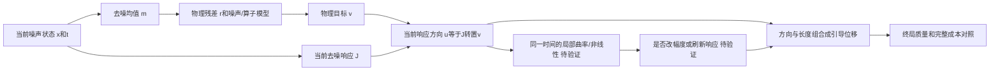

# 当前证据、资源分配和联合控制研究（2026-10-27）

这是收到进程快照后的综合分析与可执行队列，不是新GPU结果。
用户明确要求“先查进程归属，暂不终止”。本轮任何入口不发送进程终止信号。

## 一、现有资源如何使用

用户快照：GPU0 free6026MiB=5.885GiB，GPU1 free10785MiB=10.532GiB；利用率0%/2%。
GPU占用PID1081489/378093/407232分别7374/10676/13258MiB。
`ps -u lzy ... | tail -n30`没有显示这些PID，不能据此确认归属或任务是否可结束。
它截断了进程清单；低利用率是瞬时值，不证明空闲进程或可回收权限。

M1已测native峰值7.652GiB，加原1GiB余量=8.652GiB。此快照GPU1可满足，
GPU0不满足。固定分配GPU1 UUID而不是继续等待旧12GiB要求；原实时门控不降低。
新独立资源适配器`utils/a56m_no_interrupt_resume.py`用拒绝替换旧idle队列信号交接，
不改变原科学文件或plan。旧队列仍活动则停止，不抢锁、不终止任务。

ImageNet已完整3/8，第四条基线已保存。若状态未变化，还需2100原前向，复用72次profile，
不重复前三条完整案例和四条基线。旧结果resource_limited不是正在继续计算。
运行时间受共享机器影响，先观察30秒进度的新增调用数估速，不给没有测量依据的分钟保证。

两个blur用新A61 CPU任务并行数值资格，不占GPU，可与ImageNet并行。
如果8/8合成求解通过，仍需实际30点残差准入及端到端质量对照，当前不能说四任务已补齐。
本轮没有CPU卸载ImageNet、半精度、改分辨率/模型或改原采样点的方案。

## 二、实验其实围绕同一个问题

最初开题希望状态决定如何引导以及如何分配计算。目前证据将其拆成了三件必须分别证明的事：

1. **怎么修正方向**：A52/53/55/56支持保留当前完整响应方向，不仅沿原q调倍率。
2. **如何设定幅度**：物理长度标定有用，但A54/A56未证明实时幅度比旧图时间规则更好。
3. **何时需要额外计算/限制位移**：A59有部分预测信息，A60说明简单复用旧方向不行，
   还没有证明一个能提高终局质量或保持质量节省总成本的曲率控制器。

因此最强结论是“当前方向有可解释、可迁移到部分新图的作用”；
不能把当前标量g、随机余弦、曲率控制、四任务和跨数据集全部算作已证实。

## 三、当前去噪响应方向是什么

设a_t=sqrt(abar_t)，b_t²=1-abar_t，raw m_t(x)=(x-b_t eps_theta(x,t))/a_t。
物理观测A(m)=H((m+1)/2)，线性部分L=H/2，r=y-A(m)。

\[
c_t=b_t^2/a_t,\quad S_t=\sigma_y^2I+c_tLL^T,
\qquad v=L^TS_t^{-1}r,\qquad u=J_{m_t}(x)^Tv.
\]

v是去噪均值空间的物理修正目标；u通过当前去噪器的输入响应，把这个目标传回当前噪声状态。
对当前固定t、固定S的代理目标ell(x)=.5 r^T S^-1 r，链式法则给出u=-grad ell。
输入VJP计算u，不改模型参数。c_tI为各向同性代理，不是真实条件协方差。

U的位移T=K_t ||v||u/||u||；K_t由原skip系数确定。
它使位移长度等于K_t||v||、方向等于u，但不是对有限随机DDPM更新或最终PSNR的保证。
补洞时v在观测区域产生，u可通过去噪器耦合传向缺失区域；这是机制解释，
不是仅凭公式就证明缺失区域误差必降。

理论来源应明确承认：TMPD的Tweedie矩与近似似然梯度（2024版§3.1—3.2），
以及JAPS的direct/proximal耦合、Jacobian处理与投影（2026-06-21 v3§3.1—3.4）。
两篇均已核对正文公式，不仅摘要。

- [TMPD正文式6、10、11](https://arxiv.org/html/2310.06721v3)：理想条件矩关系及忽略协方差导数的近似边界。
- [JAPS正文式8—11](https://arxiv.org/html/2511.18471v3)：耦合v/u与投影。

JAPS投影比例为<v,u>/||u||²=cos(v,u)||v||/||u||；当前U使用后者的范数比而不乘cos。
这直接解释了A53“去掉余弦衰减”的研究来源。不能把使用Jacobian、投影、范数归一化当作原创理论。
代码实际使用转置VJP；有限训练网络的J并非总是理想对称PSD，不能不加说明把两者混同。
我们的潜在贡献需要是有独立证据的动作机制、成本与适用边界；仅去掉一个cos可能不足。

## 四、统一解释已有结论

|证据|真正支持|不能外推|
|---|---|---|
|A49局部目标与终局不一致|局部物理损失下降不足以代表PSNR提高|不能用局部J选到更低就宣布控制成功|
|A51/51b/A58 blur未准入|当前高噪声数值链条不可靠，须先单独处理|不是两个任务在数学上不适用|
|A53去掉cos更好|当前投影衰减可能压低有效修正|不是所有角度指标都无用|
|A54及A56 U/TIME|当前g的额外价值未确认；TIME仍计算当前u|TIME不是完全无状态规则|
|A55旧图与A56六张新FFHQ|U胜V/Q，两任务新图均6/6正向|未隔离严格“当前J对冻结J”的增量|
|A57独立无学习30调用|旧例可去掉原270学习前向且复现缓存U|不是10倍墙钟或所有任务成本结论|
|A59同t几何|总体PSNR剂量差预测MAE改善，主要来自IP|缓存强弱二选一平均仍低于gamma1，未有控制增益|
|A60方向滞后|每2/4步复用旧方向明显损失质量|旧u还含旧x/t/v，不等于仅冻结J的实验|

新FFHQ U−V：SR+1.0810dB/IP+8.0291dB；U−Q：+1.1847/+8.0273dB。
U−TIME为−.0324/−.0345dB，SR还超过SSIM/LPIPS原保护线，不宣称正式非劣。
U−C约+7.94/+8.39dB的全部差值不能作为“实时状态标量”的独立收益。
C是锁定本地ZAPS参考，未认证作者benchmark。

## 五、曲率及联合控制如何继续，而不再堆指标

以下是待实现的两个后续研究包，**本轮没有把它们伪装成可运行命令或正结果**。
先保持原30点，用户对步长选择的暂停没有被一个资源恢复脚本隐式解除。

### 包一：固定时间的有符号局部曲率→引导幅度

固定x,t,S，d=u/||u||，在同一时间沿d作两个尺度的正负探针：

\[
\kappa_\delta=\frac{\ell(x+\delta d)-2\ell(x)+\ell(x-\delta d)}{\delta^2}
\approx d^T\nabla^2\ell(x)d.
\]

这比随机相邻轨迹夹角有更清楚的对象：同t的代理目标方向曲率。
保留符号，两个尺度检查一致性；不可把它称作完整轨迹曲率、Hessian谱或真实步进误差。
沿d的局部二阶模型ell(x+sd)≈ell(x)-s||u||+.5 kappa s²，若kappa>0才有局部s*=||u||/kappa。
U基准s0=K||v||，因而候选gamma=s*/s0有推导来源；若曲率不正或尺度不一致，保持gamma1。
局部二阶模型仅作动作候选，不保证有限DDPM终局收益。

开发阶段先检查含“不动作gamma1”的机会空间：强/弱动作都差于原方法时必须不动作。
将gamma1、旧图TIME幅度、固定/时间动作、物理R/g、付费曲率、图间错配曲率作为对照。
探针前向、局部重放、所有续推、拒绝与算子动作完整收费，不能把付费曲率当免费指标。
开发只使用旧图，未用图冻结确认；先做3图小资格，再扩6图，门槛PSNR正向且SSIM/LPIPS满足原保护线。
若付费指标不能超过同成本时间/固定控制，保留为负面分析，不为其继续调多个混合权重。

### 包二：响应时效→有条件刷新，与幅度控制作2×2因子对照

A60否定固定每2/4步复用旧方向。新假设必须是“可观测变化能够辨认何时不能省VJP”，
而不是把每步u暗中算出后再声称省掉反向。每步已有m/v变化可以作廉价候选读数；
需要显式比较它相对时间是否能预测下一步方向误差，开发阶段标签可付费计算，部署阶段不许隐藏收费。
若廉价读数无增量，付费方向探针计入成本；没有真实节省则不部署。

联合2×2：固定gamma/当前响应；曲率gamma/当前响应；固定gamma/触发刷新；曲率gamma/触发刷新。
再配固定频率、时间触发、图间错配、同总预算对照。目标是质量—总成本Pareto，
不能只看前向NFE（VJP与算子可能更贵），也不能因仍胜弱C而忽略比强U/TIME退化。
只有这两轴分别有独立信息，才讨论联合规则；h/采样位置仍需独立随机耦合协议，当前不动A56。

## 六、10.31前的收口优先级

1. 先收齐ImageNet冻结8例，统一评价质量与成本；不在看见部分GT后改图/倍率。
2. 两blur先A61 CPU准入；通过后补真实去噪残差和完整质量，不把合成通过当四任务成功。
3. 固定30点优先做曲率→幅度的含gamma1动作资格；无增量就停止，不重复重开正则/余弦ridge。
4. 已支持SR/IP补第二seed与噪声边界；多任务/数据集各自列成功、失败和不确定范围。
5. 10.30冻结方法与主要图表；10.31只做必要确认/汇总，不临时增加指标追分。

当前已有硕士论文可用的机制对照和负面结论，尚无足够证据把原“曲率—联合调度—跨任务统一节省NFE”
写成全部成功。论文主张应依据新结果收缩或保留，不能承诺所有任务正向或毕业结论。

可运行命令见[资源与并行队列](20261027_resource_commands.md)。本轮Mac六项NumPy/资源契约通过，
真实Torch/FFT原算子、A61数值结果及ImageNet剩余质量均未在Mac运行。
