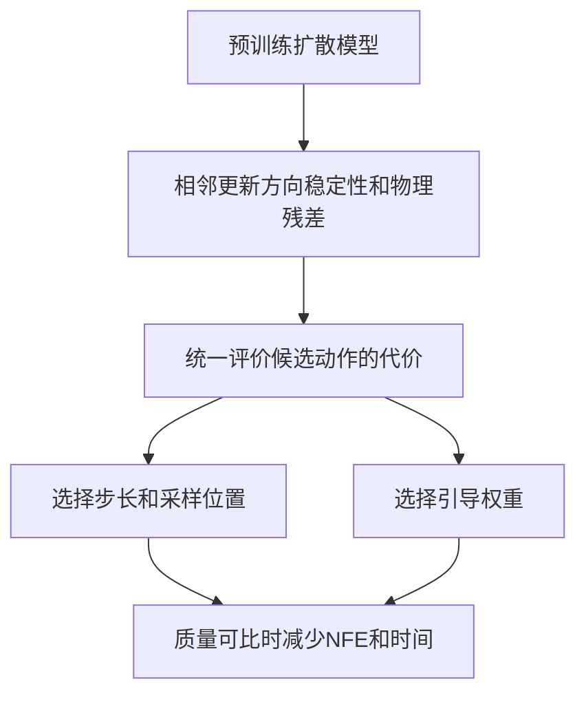
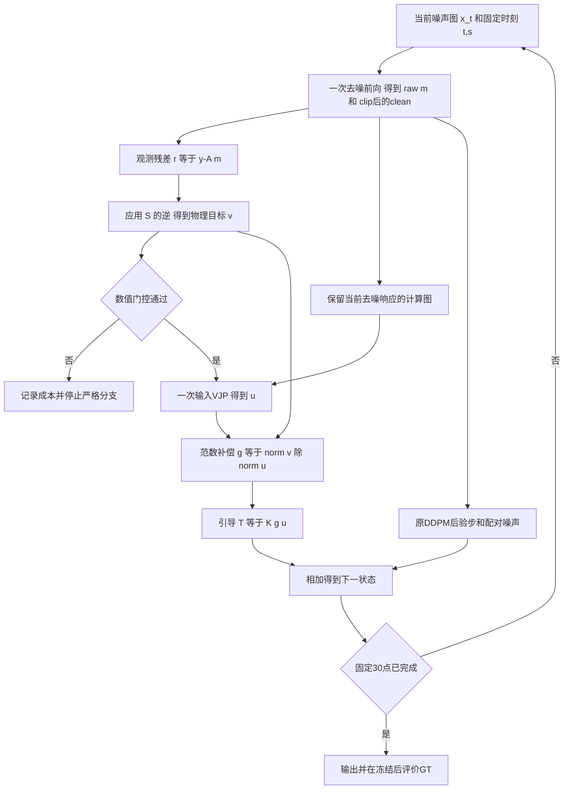

# 当前算法的动机、推导、实现和证据边界

日期：2026-10-28；实验已按用户要求暂停。本文整理既有工作，不启动实验或发布下一轮命令。

**核心判断：当前有证据支持“物理目标结合当前去噪响应，能够改善引导方向”。尚未证明原开题的
“双指标指导步长与权重联合调节，并在质量可比下减少总体计算”已实现。**

数值求解只是当前物理目标的一个实现环节。它不是状态感知的定义，也不是所有算法的必选步骤。
去掉它可以构成另外的算法，但不能不加说明地把当前U公式中的逆作用删掉，沿用原结果。

## 1. 最初究竟想解决什么

开题原题为《面向图像反问题的扩散模型状态感知自适应采样策略研究》。
原PDF物理第3、7、10、11、12页已完整提取并视觉核对，原文件未修改。

开题主线：



因此开题并非仅要求“加一个改动后PSNR更高”，而是要求状态真的影响动作、这种匹配有独立价值，
并且测量状态所花的成本没有抵消节省。原文“限制变化率确保收敛”的表述属于待证设想，
不能由有限终止或幅度限幅自动推出随机采样收敛。

原定任务是去噪、超分、高斯去模糊、补洞；目前的四项FFHQ实验为超分、高斯/运动去模糊、补洞，
其中运动是扩展，不能自动替代原定去噪。两数据集是FFHQ与ImageNet。

## 2. 当前算法在做什么

在原来固定的30个时间点上，每一步先让去噪器给出干净图估计，再读取观测误差，
并通过去噪器对输入的当前响应，把“应当怎样满足观测”转为“当前噪声图应朝哪边移动”。
目前没有根据状态选择采样点，正常分支的额外剂量倍率gamma固定为1。

主要符号：

|符号|含义|不是哪类量|
|---|---|---|
|x_t|当前含噪图像状态|不是GT|
|m_t(x_t)|未裁剪的干净图预测|不等于已知真实条件均值|
|r_t|预测通过物理模型后与观测的差|不等于全图重建误差|
|v_t|去噪均值空间里的物理修正目标|不是当前噪声状态的完整梯度|
|J_t|m_t对当前x_t的Jacobian|不是整条随机轨迹的曲率|
|u_t=J_t^T v_t|当前噪声状态的响应引导方向|不是新训练的一组网络参数|
|g_t|响应幅度的范数匹配系数|不是误差估计或最优PSNR权重|
|K_{t,s}|固定两个采样时刻之间的单位换算系数|不是状态选出的步长|
|gamma_t|对整个引导位移额外放大/缩小的倍率|当前正常分支为1|

实验代称也应按下面理解：

|代称|实际改了什么|
|---|---|
|C_IEEE|原本地ZAPS的q，使用与新方法匹配的IEEE计算精度|
|Q_ORIGINAL|保留q方向，但长度改为K乘v的范数；不是完整原基线C|
|V_PHYSICAL / V_FFT|使用Kv，不经当前去噪器输入Jacobian；仍需构造v|
|U_CURRENT / U_FFT|使用当前u方向和当前g；FFT是数值后端，不是另一种状态指标|
|TIME_GAIN|仍用当前u，只有g换成旧图的时间表|
|OLD_U|A62中使用原128-CG，数值不通过就用q；不是完全不求解|

## 3. 原ZAPS的q与当前U有什么区别

预训练去噪网络固定。令累计扩散系数为abar_t，a_t=sqrt(abar_t)，b_t²=1-abar_t。

\[
m_t(x_t)=\frac{x_t-b_t\epsilon_\theta(x_t,t)}{a_t},\qquad
\bar m_t=\operatorname{clip}(m_t,-1,1).
\]

模型图像用[-1,1]，物理观测用[0,1]。代码中的观测映射为

\[
\mathcal A(m)=H\big((m+1)/2\big)=Lm+d,\quad L=H/2,\quad d=H(1)/2.
\]

zero-padding blur边缘的d不是简单的全图常数；噪声sigma_y也必须以物理域计。
下文所有H/L的1/2由这一坐标换算产生，不是额外权重。

当前本地ZAPS基线的加性修正近似写为

\[
q_t=\frac{\zeta_{i(t)}}{a_t}
\left[I+b_t^2 W D_{i(t)}W^T\right]
L^T\big[y-\mathcal A(\bar m_t)\big].
\]

W为小波合成，W^T为分析，D是可学习对角系数，zeta为可学习引导系数。
它用小波近似先验Hessian来构造去噪响应近似，并逐观测优化zeta/D，避开每一步真实网络Jacobian反传。
这里描述锁定本地实现；尚未认证作者benchmark完全一致。

原ZAPS中被适配的是这些推理参数，预训练去噪器不重训。当前U实验则在正常分支直接构造真实输入VJP，
不用小波D来替代这一方向。继承的实验仍复用原优化前缀；不能把“模型没训练”误读为整套实验没有优化或额外成本。

依据：[ZAPS方法§3.1—3.2与Algorithm1](https://arxiv.org/html/2407.11288v1)。
代码：utils/current_score_runtime.py::field_from_mean、utils/fixed_count_state_positions.py::parameters。

## 4. v来自哪里，为什么会有线性求解

当前U使用raw m而不是clip后的m构造物理残差：

\[
r_t=y-\mathcal A(m_t(x_t)).
\]

引入一个计算代理：在当前时间，暂把干净图的不确定性表示为c_t I，代码选择

\[
c_t=\frac{b_t^2}{a_t},\qquad
S_t=\sigma_y^2 I+c_t LL^T.
\]

c_t I不是从本图估计出来的真实后验协方差；它是耦合近端与直接引导所用的各向同性近似。
S包含测量噪声以及图像不确定性通过退化算子传播后的代理项。

在临时线性高斯模型z|x_t~N(m_t,c_t I)、y=Lz+d+n下，干净图的条件均值位移为

\[
\Delta m_t=c_t L^T(\sigma_y^2I+c_t LL^T)^{-1}r_t=c_t v_t.
\]

因此定义

\[
v_t=L^T S_t^{-1}r_t.
\]

直观上，先按噪声与退化的结构加权观测误差，再把它回投到图像空间；并非单纯把残差范数放大。
这个高斯解释是局部工作模型，不是实际数据后验已经精确高斯的证明。

代码不显式生成大矩阵逆，而计算

\[
(LL^T+\eta_t I)w_t=r_t,\quad
\eta_t=\sigma_y^2/c_t,\quad
v_t=c_t^{-1}L^T w_t.
\]

对本地blur，L=H/2，所以实际系统为(.25 HH^T+eta_t I)w=r。
CG、PCG、CPU/GPU FFT讨论的是如何应用这个逆。FFT在A61/A62只加速零填充卷积动作，
没有把原零边界系统改成循环卷积后直接逐频除法求逆。

高噪声t999 eta约1.5883e-5，归一核的条件数上界约1.57e4，原128步容易达不到1e-5。
A61在新明确预算下用607—801次迭代通过，A62也通过实际轨迹；这只是数值资格。

依据：[TMPD条件矩与似然近似§3.1—3.2](https://arxiv.org/html/2310.06721v3)、
[JAPS耦合近端/直接目标§3.1](https://arxiv.org/html/2511.18471v3)。

## 5. 求解是否必须：分三层回答

**对状态感知思想：不必须。对当前U这个具体公式：必须能应用S^{-1}。对CG迭代这一种实现：不必须。**

|选择|是否需要当前S系统求解|会发生什么|
|---|---|---|
|继续原q|不需要这套求解|回到已知的本地ZAPS引导，不是当前U|
|简单观测梯度u_simple=J_t^T L^T r_t/sigma_y²|不需要这套求解，需要输入VJP|改成另一个观测度量/尺度；需独立验证，不能继承U收益|
|当前v/u|要应用S^{-1}|可用解析式、分解或数值法；不一定需要CG|

例如补洞L=M/2，M为0/1掩码，M^2=M。在有效观测子空间，

\[
v_t=\frac{M r_t/2}{\sigma_y^2+c_t/4},
\]

这是逐像素计算，不必迭代。Gaussian/Motion的零边界耦合使当前通用实现需要数值处理。
超分的难度取决于实际H及边界；不能不核对实现就套任意循环FFT闭式解。
这里的“公式可解析”不代表本地历史版本已经在该任务用了最优解析实现。

OLD_U不是严格“不求解”对照：它每步尝试原128-CG，部分失败后回退q；
V_FFT和Q_ORIGINAL也依赖v的长度/方向，所以不能把它们说成删掉求解后的版本。

A62给出的现实判断是：当前昂贵CPU全求解不是已经证明值得保留的最终设计。
Gaussian对旧U均值略有增益；Motion虽然PSNR+.082dB，LPIPS却+.01829超线，不能因为解得更准就坚持保留。
不同方案可以不做此求解，但当前没有同一协议下“无求解版本保留全部U收益”的证据。

## 6. 为什么u=J^T v能把物理目标变成当前状态的修正

固定t，把S_t视为不随x变化，定义代理误差

\[
\ell_t(x)=\tfrac12 r_t(x)^TS_t^{-1}r_t(x).
\]

J_t=partial m_t/partial x，且dr=-LJ_t dx。由链式法则：

\[
d\ell_t=-dx^T J_t^T L^T S_t^{-1}r_t,\qquad
u_t=J_t^T v_t=-\nabla_x\ell_t.
\]

该等式对固定S、可微m和精确线性解成立；它不要求网络真是理想MMSE去噪器。
但将ell当真实后验目标则需要额外概率近似。若未来采用随x变化的协方差而忽略其导数，这个等式也要限定为冻结协方差的局部代理。

代码用VJP(m,x,stop_gradient(v))直接得到u，不显式构造巨大Jacobian，不更新网络权重。
detach(v)是链式法则中正确的一阶cotangent用法，不意味着漏掉这里的一阶梯度。

补洞可作直观例子：v在未观测区域可以是0，但网络某个被观测像素的预测可能依赖缺失区域的当前噪声。
因此J^T v可在缺失区域非零，把物理信息通过去噪先验传播过去。这解释了为什么方向能不同，
不能进一步证明传播的一定是正确细节。

还要区分三种“几何”。由m=(x-b eps_theta)/a可得

\[
J_t=a_t^{-1}[I-b_t D\epsilon_\theta]
=a_t^{-1}[I+b_t^2 D s_\theta].
\]

只有在s_theta确实是某个精确log密度梯度时，D s_theta才对应该密度的Hessian。
所以当前响应含有局部先验几何的联系，但它不是已经测出的随机轨迹曲率；
用于控制的目标曲率还会涉及D u=-Hessian(ell)，也不是把J换一个名字。
更具体地，固定S时

\[
\nabla^2\ell_t=J_t^T L^T S_t^{-1}LJ_t-\sum_i (v_t)_i\nabla^2(m_t)_i.
\]

只计算一个J^T v向量，没有计算上式的曲率大小或符号，也没有据此控制步长/权重。

## 7. 幅度g与跨步K：当前控制到底是什么

当前候选U为

\[
g_t=\frac{\|v_t\|}{\|u_t\|},\qquad
T_t=K_{t,s}g_tu_t.
\]

如果去噪器对v放大很多，u较大，g就较小；反之g较大。
但g大不等于最终扰动强，因为u同时进入乘积：

\[
\|T_t\|=K_{t,s}\|v_t\|.
\]

它是物理长度与响应方向的匹配规则；并没有用一个已证实的曲率指标来判断“本步应放大”。
外部残差R=RMS_obs(r)/sigma_y当前主要用于读数/分析，不是R大就自动gamma增大的独立控制器。

K从跨步DDPM系数导出。令rho=abar_t/abar_s，

\[
C_{t,s}=\frac{\sqrt{\bar\alpha_s}(1-\rho)}{1-\bar\alpha_t},\qquad
K_{t,s}=C_{t,s}c_t=\frac{1-\rho}{\sqrt\rho}.
\]

原理是条件均值位移与似然score的单位换算：精确VP模型中Delta m=(b²/a) score_likelihood，
再乘DDPM的clean系数。实际代码有clamp且把引导在后验步之后相加；
这不是“已实现精确条件DDPM”或“选到最优步长”的证明。

当前一次更新为

\[
x_s=C_{t,s}\bar m_t+D_{t,s}x_t+\sqrt{\tilde\beta_{t,s}}\xi+\gamma_t T_t,
\quad \gamma_t=1,
\]

其中D_{t,s}=sqrt(rho)(1-abar_s)/(1-abar_t)，
beta_tilde=(1-abar_s)(1-rho)/(1-abar_t)。终端s=-1无新增噪声，代码返回clean+T；
引导加完不保证仍逐像素在[-1,1]内，评价前按原指标代码处理。

四类系数不可混淆：原ZAPS zeta是学习的引导参数；g是当前范数补偿；K是固定网格单位系数；
gamma是另一个额外剂量倍率，目前正常分支为1。

## 8. 算法流程与伪代码



以下为A62严格数值分支；旧U失败时的q回退另记，不混入这个正常算法：

```text
输入：观测 y，退化 H，已知噪声 sigma，固定30点，冻结去噪器，配对初始/创新
L = H / 2
x = 保存或按约定seed独立生成的初始噪声

for 每一固定采样区间 (t, s):
    把 x 与前一步计算图断开，允许对当前 x 求导
    eps = frozen_denoiser(x, t)                    # 一次显式前向
    m = (x - sqrt(1-abar[t]) * eps) / sqrt(abar[t])
    clean = clip(m, -1, 1)
    r = y - H((m+1)/2)                            # 使用raw m

    c = (1-abar[t]) / sqrt(abar[t])
    eta = sigma² / c
    w = solve((L L^T + eta I) w = r)
    若真实残差不通过：保存已花成本，停止该严格分支
    v = L^T w / c

    u = VJP(m, x, stop_gradient(v))               # 一次当前输入反向
    若向量数值不可分辨：记录并停止
    g = norm(v) / norm(u)
    K = (1-abar[t]/abar[s]) / sqrt(abar[t]/abar[s])
    T = K * g * u

    base = 原DDPM后验步(x, clean, t, s, 配对创新)
    x = detach(base + T)                          # 终端同样保留T

输出最终 x；所有配对输出固定后才读GT作质量评价
```

终端约定abar[-1]=1。实现还计算q用于C对照和数值可分辨门控；已解决的T表达式不依赖学习后的zeta/D。
这是算法正常分支的伪代码，不等于已经证明所有任务都可删除历史优化前缀独立30调用运行。
A57只在旧SR/IP组验证了那项等价；A56/A62的正式计费保留了各自继承协议。
一次输入VJP也不是免费计算，原checkpoint还可能在反向内部重算子模块。

## 9. 理论究竟保证到哪里

对精确数学代理，T为其下降方向，因为

\[
\nabla\ell_t(x)^T T_t=-K_{t,s}\|v_t\|\|u_t\|<0.
\]

这只谈固定t的局部纯引导方向。若ell在相关线段Lipschitz梯度，
纯更新x+gamma T的一个充分条件为0<gamma K||v||/||u||<2/L_smooth。
当前算法没有测到全局L_smooth，因此不能由该式认证固定gamma1安全。
完整DDPM还有基漂移、随机噪声、clamp以及之后29步，终局PSNR/LPIPS也不等于ell。
真实残差1e-5不能在未知条件数与J范数下直接转成u方向误差界。

已有JAPS投影为K(<v,u>/||u||²)u=K cos(v,u)||v||u/||u||；
当前U去掉cos，保留方向与物理范数。归一化、链式法则、近端/直接耦合和K均有先行依据。
不能把“用了Jacobian”或这个公式本身写成原创定理，也尚未同协议证明超过正式JAPS。

## 10. 既有结果支持怎样的故事

|条件|样本|U相对物理V的平均PSNR|能支持的范围|
|---|---|---:|---|
|FFHQ SR|6新图|+1.081dB|锁定协议的新图方向候选|
|FFHQ补洞|6新图|+8.029dB|同上|
|ImageNet SR|4新图|+1.798dB|另一数据/模型的小样本候选，3/4图正向|
|ImageNet补洞|4新图|+5.572dB|同上，4/4图正向|
|FFHQ Gaussian|5旧图|+.686dB|开发机制候选，5/5图正向|
|FFHQ Motion|5旧图|+3.968dB|开发机制候选，5/5图正向|

不是六项同等强度的确认：两blur是旧图，ImageNet仅4图一seed，V和Q本身也有状态信息。
方向与时效的A55/A56/A60对照提供支持，但尚未把“当前J对冻结J”的匹配价值完全分离。
U−C还混入残差使用raw/clip、物理加权与长度规则等改变，不能把其全部大幅提升称为新增状态价值。
U/V分叉后分别读取各自状态，匹配的是长度规则，不是每步实际范数严格相同。

实时g还没有稳定独立证据。TIME=K g_bar(task,t) u(x,t)，每步仍计算当前u；
因此U未胜TIME不是方向无效，却说明当前范数比未稳定胜过时间幅度。
ImageNet SR的U−TIME为−.108dB、SSIM−.02093；IP虽PSNR+.175dB，但LPIPS+.01465超线。

A62新U相对旧U：Gaussian+.157dB且平均保护线通过；Motion+.082dB但LPIPS+.01829超线。
旧U只77/300步解决，失败回退q；新U300/300解决。C resolved0只是该臂不构造此传感器，不是基线失败。
U累计2249秒，V2231秒，CPU数值求解主导；此成本不符合已实现轻量高效的结论。

A59同t局部几何对剂量差预测有部分信息，主要来自补洞，但原二选一动作平均仍低于不动作gamma1；
A60固定间隔复用旧方向明显降质。它们给出研究线索，不是曲率控制已改善质量的证据。

原开题“残差大就增大权重”需要另外的动作证据：残差大可能表示还没修好，也可能表示噪声、不确定性或代理失配。
“相邻更新夹角大就降低权重/缩步”也需要识别性：相邻随机DDPM更新同时变了t、噪声和状态，
即便确定性漂移不弯，随机创新也会改变夹角。因此这两条规则不是从指标定义直接推出的定理。

## 11. 与开题的逐项对照和结论

|开题内容|当前真实状态|
|---|---|
|物理一致性指标|残差可测，物理加权目标有解释；残差低不等于全图质量高|
|内部轨迹稳定性指标|原随机相邻余弦没有稳定独立增量；当前J响应不是它的已证实等价物|
|指标指导权重|有范数匹配公式；实时g优于强TIME未稳定成立|
|统一评价函数|当前ell只描述局部物理代理，不是同时包含轨迹稳定性、动作收益与计算成本的统一代价|
|自适应步长/采样位置|当前固定原30点，未完成且暂停|
|步长与权重联合控制|未实现有独立证据的联合控制|
|轻量化/质量可比节省NFE|旧两任务有独立30调用等价线索；总成本/多任务效率未成立，blur CPU明显昂贵|
|多任务/多数据集|部分成立的方向候选，不是开题全部任务或噪声条件完成|

可成立的当前叙事是：静态或近似的物理回投未充分反映去噪器对当前状态的响应；
使用真实当前响应可在已测任务中改善方向；范数标定和数值近似的影响需要分离，
实时标量与曲率是否能产生额外控制收益仍待验证。

尚不成立的叙事是：已经构建低成本的双状态曲率控制器，自动选步/调权，在多任务上稳定提高质量并节省总计算。
这是有部分正向结果、但主张边界需要收紧的研究，不是开题整体已完成，也不是已有证据说明所有状态感知均不可行。
若以当前状态作为论文方法，直接使用J/归一化的先行工作密集，独立创新贡献不足以自动由大幅U−C结果证明。
论文是否足以提交需要与导师讨论范围和证据；不能承诺毕业结论。

## 12. 暂停后如何解释下一步，不启动它

先决定论文要证明哪一个明确主张：方向响应、幅度反馈、曲率动作或计算分配。
当前最接近成立的是方向响应；与原开题最接近、但尚缺的环节是“某个可解释状态怎样决定动作，且匹配优于时间/固定/错配”。
真实曲率应在固定t下沿确定方向测量局部响应或代理目标二阶变化，避免随机相邻轨迹混杂；
它也必须胜过含gamma1的动作参照，不能只展示相关性或局部损失下降。
这些是论证需求，不是本轮启动的新实验计划。A63草案未发布/未运行。

## 来源与复核

- 原开题：/Users/liziyue.22/Desktop/论文文档/研究生学位论文开题报告-李子玥-2240502010.pdf。
  物理第3/7/10/11/12页全文与页面视觉核对；SHA728d0078fac1f3f1c9b5ea75dd2e2f5f84d49ca6d74d28ebc5d3e23a38fb0499。
- [ZAPS 2024作者预印本，方法和Algorithm1](https://arxiv.org/html/2407.11288v1)。
- [TMPD v3 2024-09-25，条件矩/近似似然](https://arxiv.org/html/2310.06721v3)。
- [JAPS v3 2026-06-21，条件均值关系/耦合方向/投影](https://arxiv.org/html/2511.18471v3)。
- 当前源码：current_score_runtime.py::raw_mean/field_from_mean，current_score_geometry.py::proximal_vector/input_vjp/skip_coefficient，
  angular_feedback_control.py::controlled_target，common_state_risk.py::advance，modules/zaps_algorithm.py::ddpm_posterior_step。
- A56完整轻量核验：../20261027_completed_transfer_received/；A62完整轻量核验：../20261028_a62_received/。
- 既有公式草稿../../overnight_20261027/FORMULAS.md中的“待运行”是历史时间点，不用它覆盖本页最新A56—A62证据。
